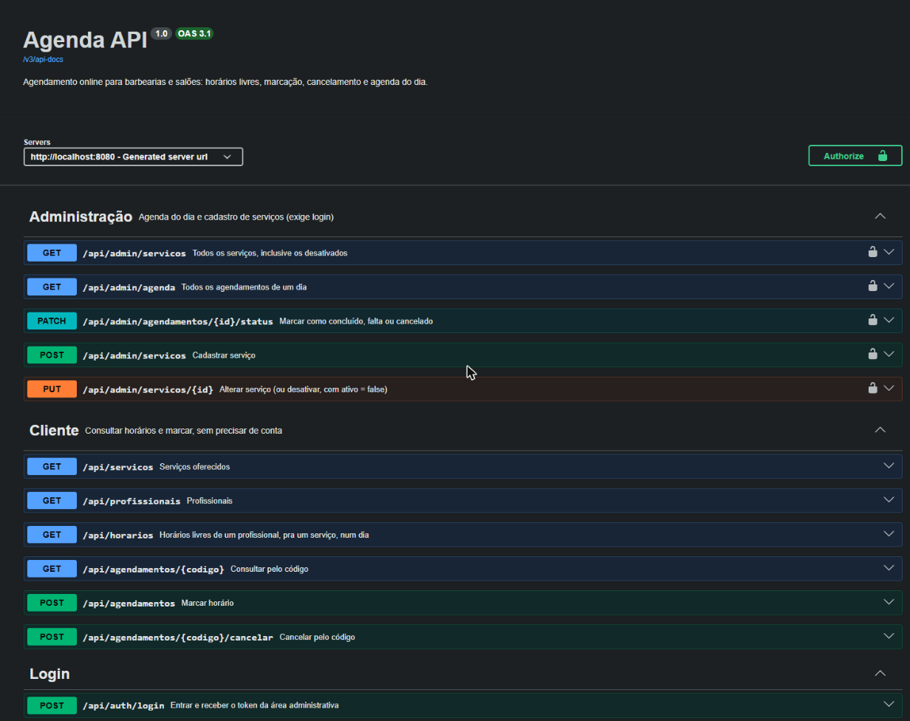

# Agenda API

API de agendamento online para barbearias e salões, em **Java 21 + Spring Boot**. O cliente vê os
horários livres, marca sem precisar criar conta e recebe um código para consultar ou cancelar. O
dono entra com login e vê a agenda do dia.

O front que usa esta API está em [agenda-web](https://github.com/edudiasr/agenda-web).



## Tecnologias

Java 21 · Spring Boot 4 (Web MVC, Data JPA, Validation, Security) · PostgreSQL · Flyway ·
JWT · JUnit 5 · Testcontainers · Swagger (springdoc) · Docker · GitHub Actions

## Como a agenda funciona

- Cada profissional tem um **expediente** por dia da semana (ex.: terça a sábado, 9h às 18h).
- Os horários começam de **15 em 15 minutos**. Um horário aparece como livre se o serviço inteiro
  cabe antes do fim do expediente e não encosta em nenhum outro agendamento.
- É preciso marcar com **30 minutos de antecedência** e só dá pra cancelar pelo site até
  **2 horas antes**. Os dois valores ficam no `application.yml`.
- O cliente recebe um **código de 6 letras** sem caracteres que se confundem (sem 0/O, 1/I/L),
  porque às vezes ele dita o código pelo telefone.

O cálculo dos horários livres fica numa classe separada (`CalculadoraDeHorarios`) que não acessa
o banco nem o relógio: recebe o expediente, a duração e os horários ocupados e devolve a lista.
Por isso cada regra tem um teste de unidade simples.

## Dois clientes no mesmo horário

O caso que mais me preocupou: dois clientes abrem a página, veem o mesmo horário livre e
confirmam ao mesmo tempo. Conferir no Java antes de salvar não resolve, porque os dois passam
na conferência antes de qualquer um gravar.

Por isso a garantia está **no banco**, com uma restrição de exclusão do PostgreSQL:

```sql
CONSTRAINT agendamento_sem_sobreposicao
    EXCLUDE USING gist (profissional_id WITH =, tstzrange(inicio, fim) WITH &&)
    WHERE (status <> 'CANCELADO')
```

Ela não deixa existir dois agendamentos do mesmo profissional cujos intervalos se sobrepõem
(cancelados não contam, então o horário volta a ficar livre). Quando a restrição barra o segundo
cliente, a API devolve **409** com "Esse horário acabou de ser ocupado. Escolha outro.".

Isso é testado de verdade: 10 requisições disparadas ao mesmo tempo para o mesmo horário, e
exatamente uma é gravada.

## Endpoints

| Método | Rota | Quem usa |
|---|---|---|
| GET | `/api/servicos`, `/api/profissionais` | cliente |
| GET | `/api/horarios?profissionalId=&servicoId=&data=` | cliente |
| POST | `/api/agendamentos` | cliente: devolve o código |
| GET | `/api/agendamentos/{codigo}` | cliente |
| POST | `/api/agendamentos/{codigo}/cancelar` | cliente |
| POST | `/api/auth/login` | dono: devolve o token JWT |
| GET | `/api/admin/agenda?data=` | dono (token) |
| PATCH | `/api/admin/agendamentos/{id}/status` | dono: atendido, faltou, cancelado |
| GET/POST/PUT | `/api/admin/servicos` | dono: cadastro de serviços |

A documentação interativa fica em `/swagger-ui.html`.

Os erros saem sempre no mesmo formato (Problem Details, RFC 9457), com a mensagem pronta para
mostrar na tela e, nos erros de validação, a mensagem de cada campo:

```json
{
  "status": 400,
  "detail": "Confira os campos destacados.",
  "campos": { "clienteTelefone": "Telefone no formato (47) 99999-9999" }
}
```

## Segurança

- Login devolve um **JWT assinado (HS256)** com validade de 8 horas. As rotas `/api/admin/**`
  exigem o token; o resto da API é público.
- Senhas guardadas com **BCrypt**.
- Login errado dá a mesma mensagem para e-mail inexistente e senha errada, para não revelar
  quais e-mails têm conta.
- O primeiro administrador é criado a partir das variáveis `ADMIN_EMAIL` e `ADMIN_SENHA`, então
  nenhuma senha fica no código ou nas migrações.
- **CORS** liberado só para a origem do front (`CORS_ORIGENS`).

## Testes

19 testes: 6 de unidade (cálculo de horários) e 13 de integração que sobem a aplicação inteira com
um **PostgreSQL de verdade em container** (Testcontainers) e chamam a API como o front chamaria.
O relógio da aplicação é substituído por um relógio controlado pelo teste, assim dá pra testar
"cancelar 1 hora antes" e "token vencido depois de 8 horas" sem esperar.

```
./mvnw verify
[INFO] Tests run: 19, Failures: 0, Errors: 0, Skipped: 0
```

Alguns casos testados:

- marcar tira o horário da lista (e também os horários que terminariam dentro dele)
- 10 clientes no mesmo horário ao mesmo tempo: só um consegue
- fora do expediente, dia de folga, data passada e sem antecedência mínima: recusado
- cancelar libera o horário, mas não a menos de 2 horas
- área do dono: sem token, token falso e token vencido dão 401
- CORS: o front configurado é aceito e outra origem é recusada

Dois bugs que os testes pegaram durante o desenvolvimento:

- **Token que não vencia.** O teste de expiração não conseguia testar nada, porque o validador
  do JWT usava o relógio do sistema e não o da aplicação. Hoje os dois usam o mesmo `Clock`.
- **CORS que não funcionava.** O Spring Security só usa a configuração de CORS se o bean se
  chamar `corsConfigurationSource`. O meu tinha outro nome, era ignorado sem nenhum aviso, e o
  navegador bloqueava todas as chamadas do front. Agora tem teste para isso.

## Rodando

Precisa de Java 21 e Docker (para o PostgreSQL).

```bash
docker run -d --name agenda-pg -e POSTGRES_DB=agenda -e POSTGRES_USER=agenda \
  -e POSTGRES_PASSWORD=agenda_dev -p 5432:5432 postgres:17-alpine

ADMIN_EMAIL=voce@exemplo.com ADMIN_SENHA=uma-senha-longa ./mvnw spring-boot:run
```

A API sobe em `http://localhost:8080`, com uma barbearia de exemplo (4 serviços e 2 profissionais)
criada pela migração `V2__barbearia_exemplo.sql`.

Variáveis: `DB_HOST`, `DB_PORT`, `DB_NAME`, `DB_USER`, `DB_PASSWORD`, `JWT_SEGREDO` (32+
caracteres), `ADMIN_EMAIL`, `ADMIN_SENHA`, `CORS_ORIGENS`.

O `render.yaml` cria o banco e a API no Render com um clique (Blueprint).

## Estrutura

```
src/main/java/dev/edudiasr/agenda/
  agenda/       regras (AgendaService, CalculadoraDeHorarios), controllers e DTOs
  dominio/      entidades JPA e repositórios
  seguranca/    Spring Security, login com JWT, criação do primeiro admin
  erro/         exceção de negócio e tratamento de erros
src/main/resources/db/migration/   migrações Flyway (estrutura e dados de exemplo)
src/test/                          testes de unidade e de integração
```

## Licença

MIT
